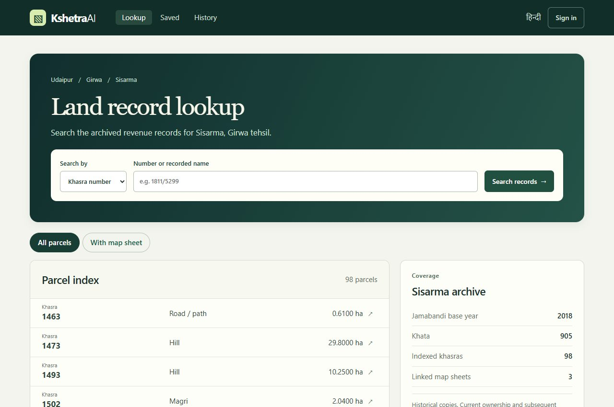
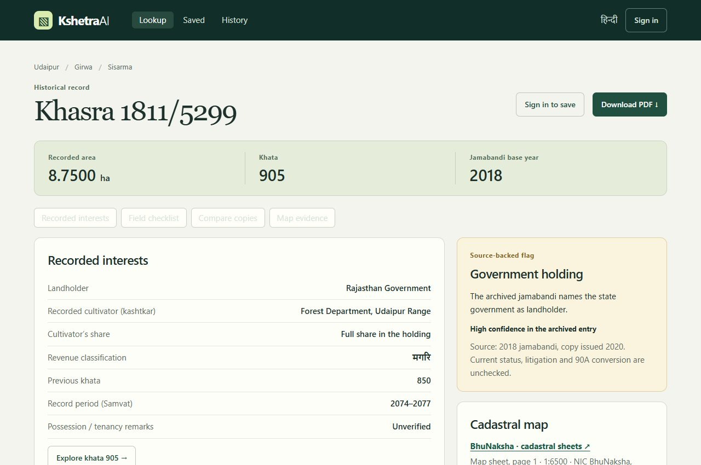
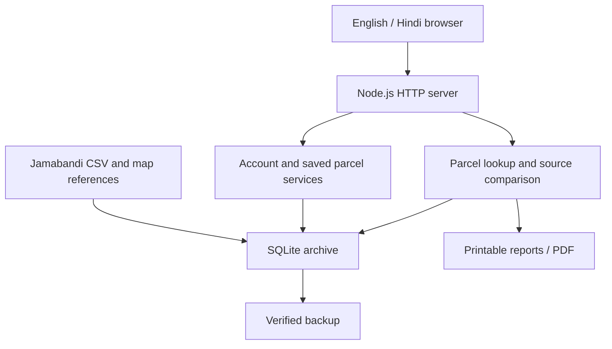

<div align="center">

# KSHETRA AI · क्षेत्र

### A step toward transparent land records in India.

**Find the parcel. Read the record. Follow the evidence.**

[](https://github.com/atharvtamboli/Kshetra_AI/actions/workflows/pilot.yml)


[Run the pilot](#quick-start) · [Demo walkthrough](docs/DEMO.md) · [Data provenance](DATA.md) · [Architecture](#architecture)

</div>

---

## The idea

Imagine a buyer or landholder trying to understand a khasra number from a revenue record. KshetraAI brings the recorded interests, area, historical evidence and outstanding checks into one bilingual workspace so people can ask informed questions before a land transaction.

The first working pilot covers one historical holding in **Sisarma, Girwa, Udaipur, Rajasthan**.

## See it in action





## What is built

| Land-record research | Working capabilities |
| --- | --- |
| **Parcel explorer** | 98 archived khasras, Hindi and English search, khata and recorded institutional-name lookup |
| **Ownership evidence** | Recorded landholder and cultivator, holding share, source date, area and previous khata |
| **Map evidence** | Three linked BhuNaksha sheets, parcel filtering and field-by-field comparison |
| **Due diligence** | Source-backed government holding flag, outstanding checks and official service links |
| **Portable reports** | Bilingual downloadable PDF with field checklist and evidence references |
| **Personal workspace** | Local accounts, private saved parcels, search history and sign-out |
| **Data integrity** | SQLite storage, source control totals, access-log expiry and verified backup snapshots |

## Quick start

Requirements: **Node.js 24+**, a modern browser, and Chrome or Edge for PDF export. No API key or paid service is required.

```sh
git clone https://github.com/atharvtamboli/Kshetra_AI.git
cd Kshetra_AI
npm start
```

Open **http://127.0.0.1:3000**. On Windows, double-click **Start-KshetraAI.cmd** to create the local environment file and launch the app. For a guided walkthrough, start with khasra **1811/5299**.

## Architecture



| Directory | Responsibility |
| --- | --- |
| src/ | Search, validation, rendering and PDF export |
| public/ | Responsive styles and legacy launch pages |
| records/ | Historical parcel facts and source metadata |
| scripts/ | Backup tooling |
| tests/ | Archive, account and recovery regression checks |
| docs/ | Demo, operations and screenshots |
| var/ | Private local database and runtime files, excluded from Git |

## Test and operate

```sh
npm test
npm run backup
```

Start the app before using the backup command. The service exposes /healthz for a database readability check. See [local operations](docs/OPERATIONS.md) for configuration, privacy and recovery.

## From village pilot to Rajasthan

The current archive contains 98 khasras totaling 910.3300 hectares under khata 905. Three records have independently linked cadastral sheets. Their source dates are visible throughout the app.

Next milestones are a fresh authorised revenue extract, matching georeferenced boundaries, repeatable record-change checks and a reviewed deployment. Current title, litigation, possession and conversion remain unverified. See the [data inventory](DATA.md) for scope and outstanding evidence.

---

<div align="center">

**Made for India. Built around evidence.**

</div>

